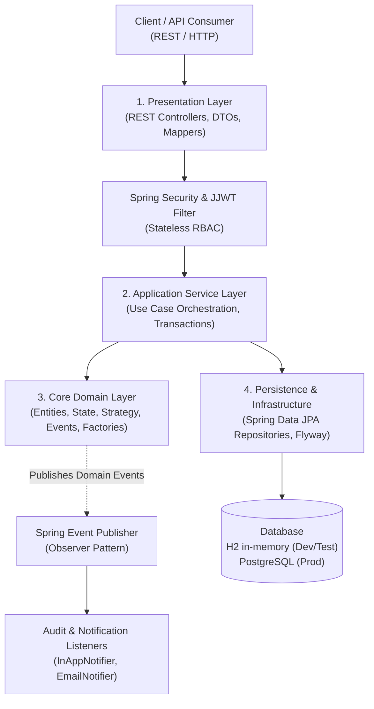
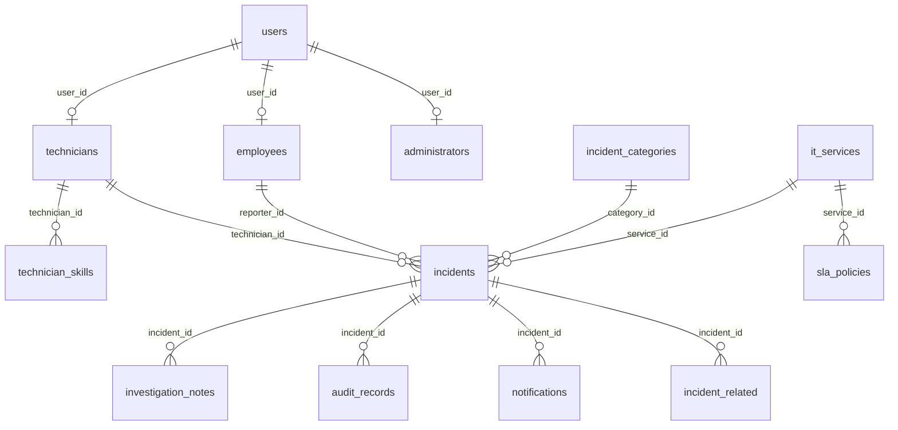

# Resolvo System Architecture Document

> **System**: Resolvo: Intelligent IT Service Management & Incident Resolution System
> **Course**: CS F213 / MAC F212 Object-Oriented Programming
> **Language**: Java 21 (Strictly enforced)
> **Framework**: Spring Boot 3.3.5

---

## 1. Architectural Overview & Design Philosophy

The Resolvo backend is engineered according to **Domain-Driven Design (DDD)** and **Clean Layered Architecture** principles. Business rules, invariants, and lifecycle transitions are fully encapsulated within the rich Domain Layer rather than leaked into framework controllers or database triggers.

---

## 2. Layer Responsibilities & Strict Boundaries

### 2.1 Presentation Layer (`com.iitsm.api`)
- **Controllers** (`com.iitsm.api.controller`):
  - Strictly stateless and free of business logic.
  - Responsible solely for HTTP request decoding, path mapping, invoking application services, and returning structured `ApiResponse<T>` envelopes.
  - Enforce method-level security with `@PreAuthorize("hasRole('ADMIN')")` or role-specific accessors.
- **DTOs** (`com.iitsm.api.dto`):
  - Immutable Java `record`s for all requests and responses.
  - Input validation performed declaratively via Jakarta Bean Validation (`@NotBlank`, `@NotNull`, `@Min`, `@Max`, `@Email`).
  - Entities are **never** returned directly to clients, preventing accidental schema leakage or lazy loading errors.
- **Mappers** (`com.iitsm.api.mapper`):
  - Pure transformation components (`IncidentMapper`, `UserMapper`, `CatalogMapper`) mapping between JPA entities and response DTOs.
- **Central Exception Advice** (`com.iitsm.api.advice.GlobalExceptionHandler`):
  - Catches domain-specific exceptions (`InvalidStateTransitionException`, `TechnicianUnavailableException`, `UnauthorizedOperationException`, etc.) and formats uniform RFC-compliant JSON error bodies.

### 2.2 Security Layer (`com.iitsm.security` & `com.iitsm.config`)
- **Stateless JWT Authentication**:
  - `JwtTokenProvider`: Issues and cryptographically validates HMAC-SHA256 tokens carrying user identity and role authorities.
  - `JwtAuthenticationFilter`: Intercepts inbound requests, extracts `Bearer` tokens, validates claims, and populates the `SecurityContextHolder`.
- **Role-Based Access Control (RBAC)**:
  - Supports three distinct roles: `EMPLOYEE`, `TECHNICIAN`, `ADMIN`.
  - URL pattern security in `SecurityConfig`:
    - Public: `/api/auth/**`, `/v3/api-docs/**`, `/swagger-ui/**`, `/h2-console/**`.
    - Protected: `/api/admin/**` (ADMIN only), `/api/technician/**` (TECHNICIAN only), `/api/employee/**` (EMPLOYEE only), `/api/incidents/**` (Authenticated).

### 2.3 Application Service Layer (`com.iitsm.service`)
- **Use-Case Orchestration**:
  - Manages database transaction boundaries (`@Transactional`).
  - Coordinates domain factories, strategy resolvers, repositories, and event publishers.
  - Key services include `IncidentService`, `UserService`, `TechnicianService`, `ItServiceService`, `CategoryService`, `SlaPolicyService`, `AuditService`, `NotificationService`, `ReportService`, and `SlaMonitorService`.

### 2.4 Domain Model Layer (`com.iitsm.domain`)
- Independent of presentation and framework infrastructure.
- Encapsulates state, business rules, lifecycle transitions, and validation invariants.
- Contains the classic OOP design patterns:
  - **State Pattern**: `IncidentState` hierarchy governing lifecycle transitions.
  - **Strategy Pattern**: Interchangeable `PriorityCalculator` and `AssignmentStrategy` algorithms.
  - **Observer Pattern**: Sealed `DomainEvent` hierarchy and decoupled listeners.
  - **Factory Pattern**: `IncidentFactory`, `UserFactory`, and `NotifierFactory`.

### 2.5 Intelligence Layer (`com.iitsm.intelligence`)
- **`DuplicateDetector`**: Tokenized Jaccard similarity engine detecting duplicate anomalies across IT services within a 7-day lookback window.
- **`SmartTechnicianRecommender`**: Multi-factor scoring model ranking technician assignment suitability across skills (40%), capacity (25%), seniority (20%), and service affinity (15%).
- **`AutoEscalationService`**: Extension point interface for future automated escalation policies.

### 2.6 Persistence Layer (`com.iitsm.repository`)
- 11 Spring Data JPA repositories with custom derived queries, JPQL aggregations, and `JpaSpecificationExecutor` for dynamic search filtering.
- Managed database migrations via Flyway (`V1__init_schema.sql` and `V2__seed_data.sql`).

---

## 3. Database Architecture & Inheritance Mapping

The database schema utilizes the **`JOINED` Inheritance Strategy** for polymorphic user hierarchies (`users` $\leftarrow$ `employees`, `technicians`, `administrators`). This avoids sparse NULL columns of single-table inheritance while preserving relational integrity and foreign key constraints.

---

## 4. Operational Threading & Scheduling

- **Stateless Execution**: Each HTTP request is handled independently in the Tomcat servlet thread pool.
- **Periodic SLA Background Monitor**:
  - `SlaMonitorService.runScheduledSlaCheck()` executes every 60 seconds (`@Scheduled(fixedRate = 60000)`).
  - Scans active, unclosed incidents.
  - Computes elapsed time ratio; when elapsed window $\ge 80\%$, marks SLA as `APPROACHING` and fires `SlaApproachingEvent`.
  - When reference time exceeds deadlines, marks SLA as `VIOLATED` and fires `SlaViolatedEvent`.
