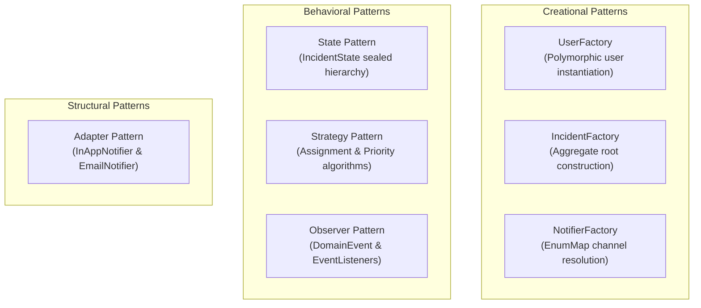
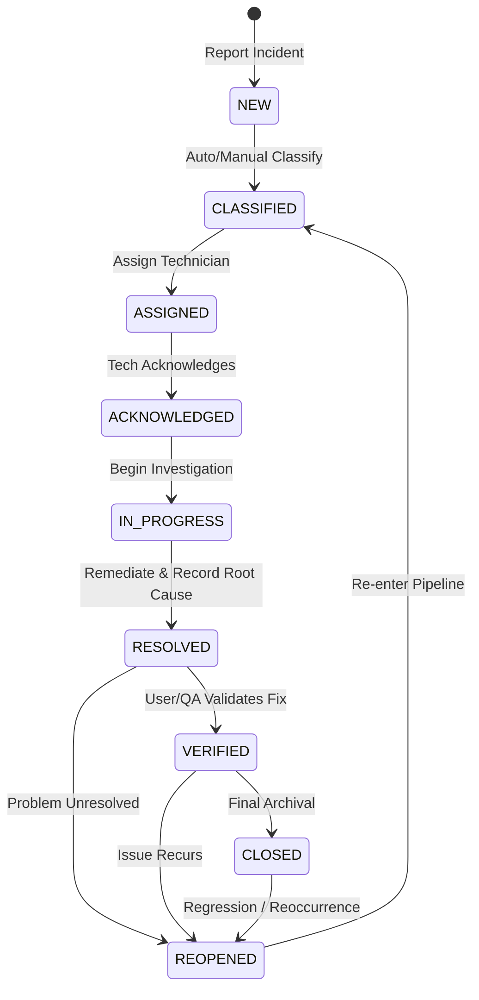

# Resolvo Object-Oriented Design & Pattern Reference

> **Course**: CS F213 / MAC F212 Object-Oriented Programming
> **Viva Defense Guide**: Complete mapping of core OOP tenets and Gang of Four (GoF) design patterns to application source files.

---

## 1. Mapping of Core OOP Tenets to Codebase

| OOP Concept | Applied In Classes / Packages | Concrete Implementation Details |
|---|---|---|
| **Encapsulation** | `com.iitsm.domain.model.Incident`, `SlaTracking`, `User` | All entity fields are `private` and `final` where applicable. Mutation of lifecycle status is strictly prohibited via public setters; state changes are exclusively executed via state transitions (`transitionTo`, `resolve`, `close`, `reopen`). Invariants are enforced in constructors. |
| **Abstraction** | `PriorityCalculator`, `AssignmentStrategy`, `Notifier`, `AutoEscalationService` | Business abstractions define high-level behavioral contracts without exposing algorithmic details (e.g., `AssignmentStrategy.assign()` or `Notifier.send()`). |
| **Inheritance** | `User` (abstract) $\leftarrow$ `Employee`, `Technician`, `Administrator` | Natural "is-a" relationship mapped relationally via JPA `@Inheritance(strategy = InheritanceType.JOINED)`. Derived classes extend the base entity with specialized attributes (e.g., `Technician.skills`, `Employee.department`). |
| **Polymorphism** | `UserFactory`, `AssignmentStrategy`, `Notifier`, `IncidentState` | Strategy implementations (`SkillBasedAssignment`, `LoadBasedAssignment`, `RoundRobinAssignment`) are invoked polymorphically by `AssignmentStrategyManager`. `Notifier` adapters are called uniformly by `NotificationService`. |
| **Composition** | `Incident` has-a `SlaTracking`, `Resolution`, `Feedback` | JPA `@Embeddable` value objects. They share their enclosing `Incident` lifecycle and have no independent database existence. |
| **Aggregation** | `Technician` aggregates `technician_skills` (`Set<String>`) | Skills exist independently as domain strings and are aggregated into the technician's profile via `@ElementCollection`. |
| **Association** | `Incident` associates `reporter` (`Employee`), `affectedService` (`ItService`), `assignedTechnician` (`Technician`) | Navigable `@ManyToOne` relationships referencing foreign entities that have independent lifecycles. |
| **Collections Choice** | `NotifierFactory`, `LoadBasedAssignment`, `IncidentSpecification` | - `EnumMap`: Used in `NotifierFactory` for $O(1)$ constant-time channel lookup with minimal memory overhead. - `PriorityQueue`: Used in `LoadBasedAssignment` as a min-heap to sort candidate technicians by active workload. - `Set<String>`: Used for technician skills and Jaccard tokens for deduplication and $O(1)$ set intersection (`retainAll`). - `List`: Immutable lists (`List.copyOf`) returned from services. |
| **Exception Hierarchy** | `com.iitsm.domain.exception.*` | 12 custom runtime exceptions extending `RuntimeException` (`InvalidStateTransitionException`, `TechnicianUnavailableException`, `WorkloadExceededException`, `UnauthorizedOperationException`, etc.), centrally translated into RFC 7807 problem details by `GlobalExceptionHandler`. |

---

## 2. Design Patterns Catalog & Technical Implementation

---

### 2.1 State Pattern: Incident Lifecycle Management
- **Classes**: Sealed interface `IncidentState` and 9 concrete state classes: `NewState`, `ClassifiedState`, `AssignedState`, `AcknowledgedState`, `InProgressState`, `ResolvedState`, `VerifiedState`, `ClosedState`, `ReopenedState`.
- **Purpose**: Replaces messy, error-prone `switch`/`if-else` blocks with dedicated state objects. Each state explicitly declares allowed forward and backward transitions via `getAllowedTransitions()`.
- **State Machine Workflow**:

- **Enforcement**: If a caller attempts an illegal transition (e.g. `NEW` directly to `CLOSED`, or `ASSIGNED` directly to `RESOLVED`), `Incident.transitionTo()` throws `InvalidStateTransitionException` with an explicit reason.

---

### 2.2 Strategy Pattern: Interchangeable Business Algorithms

#### 2.2.1 Technician Assignment Strategies
The system implements the Strategy Pattern for assigning technicians to incidents. An administrator can switch the active strategy at runtime via the API (`POST /api/admin/assignment/strategy`) without server restarts.

1. **`SkillBasedAssignment`**:
   - Matches technician skills against the incident category and keyword tokens.
   - Filters only available technicians below max capacity.
   - Ranks matches by `ExperienceLevel` descending (EXPERT > SENIOR > MID > JUNIOR).
2. **`LoadBasedAssignment`**:
   - Uses a `PriorityQueue` (min-heap) to select the technician with the least active workload.
   - Breaks workload ties by seniority.
3. **`RoundRobinAssignment`**:
   - Uses an atomic cyclical counter (`AtomicInteger`) to balance ticket distribution evenly across the available technician team.

#### 2.2.2 Weighted Priority Calculation (`WeightedPriorityCalculator`)
Computes business priority ($P1$ to $P4$) using a transparent multi-factor formula:

$$\text{Base Score} = \text{Impact.weight} \times \text{Urgency.weight} \times \text{BusinessCriticality.weight}$$

$$\text{Affected User Bonus} = \begin{cases} 10 & \text{if users} > 100 \\ 5 & \text{if users} > 50 \\ 2 & \text{if users} > 10 \\ 0 & \text{otherwise} \end{cases}$$

$$\text{Total Score} = \text{Base Score} + \text{Affected User Bonus}$$

| Total Score Range | Priority Tier | SLA Classification |
|---|---|---|
| $\ge 48$ | **P1** | Critical |
| $18 - 47$ | **P2** | High |
| $6 - 17$ | **P3** | Medium |
| $1 - 5$ | **P4** | Low |

---

### 2.3 Observer Pattern: Decoupled Domain Events
- **Contract**: Sealed interface `DomainEvent` with 8 immutable record events:
  - `IncidentCreatedEvent`, `IncidentStatusChangedEvent`, `IncidentAssignedEvent`, `IncidentPriorityChangedEvent`, `SlaApproachingEvent`, `SlaViolatedEvent`, `IncidentResolvedEvent`, `IncidentClosedEvent`.
- **Decoupled Observers**:
  1. **`AuditEventListener`**: Automatically records immutable audit log rows in the `audit_records` table whenever a domain event occurs. Core incident logic knows nothing about audit tables.
  2. **`NotificationEventListener`**: Translates domain events into multi-channel alerts dispatched to reporters, technicians, and administrators.

---

### 2.4 Factory Pattern
1. **`UserFactory`**: Instantiates concrete subclasses (`Employee`, `Technician`, `Administrator`) based on `Role` while validating role-specific prerequisites (e.g. experience level and capacity for technicians).
2. **`IncidentFactory`**: Enforces default state initialization, assigns default priority $P4$, and sets up empty embedded value objects (`SlaTracking`, `Resolution`, `Feedback`).
3. **`NotifierFactory`**: Uses an `EnumMap` to dynamically resolve notification channel adapters (`IN_APP`, `EMAIL`).

---

### 2.5 Adapter Pattern
- **Interface**: `Notifier` (`getChannel()`, `send(Notification notification)`).
- **Adapters**:
  - `InAppNotifier`: Adapts internal session notification delivery.
  - `EmailNotifier`: Adapts simulated SMTP email dispatch with formatted message headers.

---

## 3. Student Viva Defense: Key Questions & Answers

### Q1: Why use `record`s for DTOs and Domain Events instead of standard Java classes?
> **Answer**: Java 21 `record`s provide concise, immutable data carriers with compiler-generated getters, `equals()`, `hashCode()`, and `toString()`. For DTOs and domain events, immutability guarantees thread-safety and prevents accidental state mutation after publication.

### Q2: Why did you choose JPA `JOINED` inheritance over `SINGLE_TABLE` for `User`?
> **Answer**: With `SINGLE_TABLE`, technician-specific attributes like `skills`, `max_workload`, and `experience_level` would be nullable columns on rows for employees and admins, violating database normalization and precluding NOT NULL integrity constraints. `JOINED` creates dedicated tables linked by primary key foreign keys, cleanly reflecting the OOP class hierarchy in relational form.

### Q3: How is encapsulation preserved without using Lombok?
> **Answer**: All entity fields are private. State-altering operations are represented as intention-revealing methods (e.g. `startInvestigation()`, `resolve()`, `reopen()`) rather than arbitrary setters. Invariants (e.g. ratings between 1 and 5, non-null titles, valid state transitions) are enforced at the exact point of mutation.
