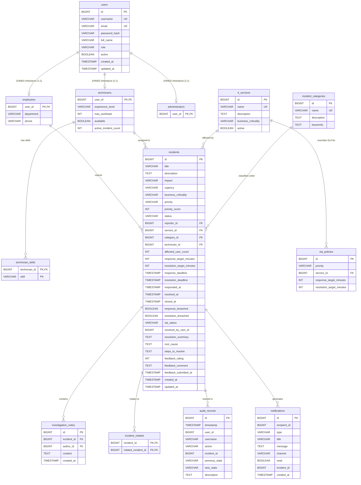

# Resolvo Entity-Relationship (ER) Diagram

> **Persistence**: Relational Schema (PostgreSQL & H2 In-Memory)
> **Migration Management**: Flyway Database Migrations (`V1__init_schema.sql`, `V2__seed_data.sql`)

