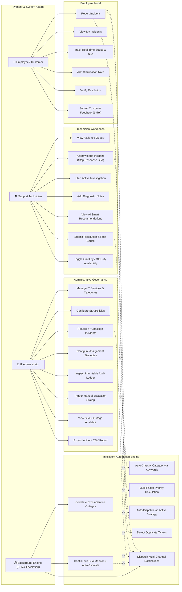

# Resolvo UML Use Case Diagram

> **System**: Resolvo Intelligent IT Service Management & Incident Resolution System (I-ITSM)  
> **Course**: CS F213 / MAC F212: Object-Oriented Programming (OOP)  
> **Standard**: Course Specification §7 Deliverables (Page 14)

---

## Use Case Actor Summary

| Actor | Description | Key Responsibilities |
| :--- | :--- | :--- |
| **Employee / Customer** | End user in an organization consuming enterprise IT services | Reports technical issues, monitors progress, provides supplemental clarifications, verifies resolutions, rates support satisfaction. |
| **Support Technician** | Tier-1 to Tier-3 support engineer with domain specializations | Manages assigned ticket queue, acknowledges incidents to stop response clock, conducts diagnostics, logs investigation notes, resolves root causes, manages personal availability. |
| **IT Administrator** | Operations manager and system administrator | Maintains IT Service Catalog, defines SLA matrices, manages user accounts, overrides ticket assignments or unassigns tickets, switches routing strategies, audits system activities, and reviews organizational MTTR/MTTA reliability metrics. |
| **Background Engine** | Automated continuous scheduler (`@Scheduled`) and domain event bus | Periodically checks SLA deadlines every 30s, identifies approaching breaches, executes multi-tier escalation, calculates outage blast radius clusters, and dispatches in-app/simulated email alerts. |
